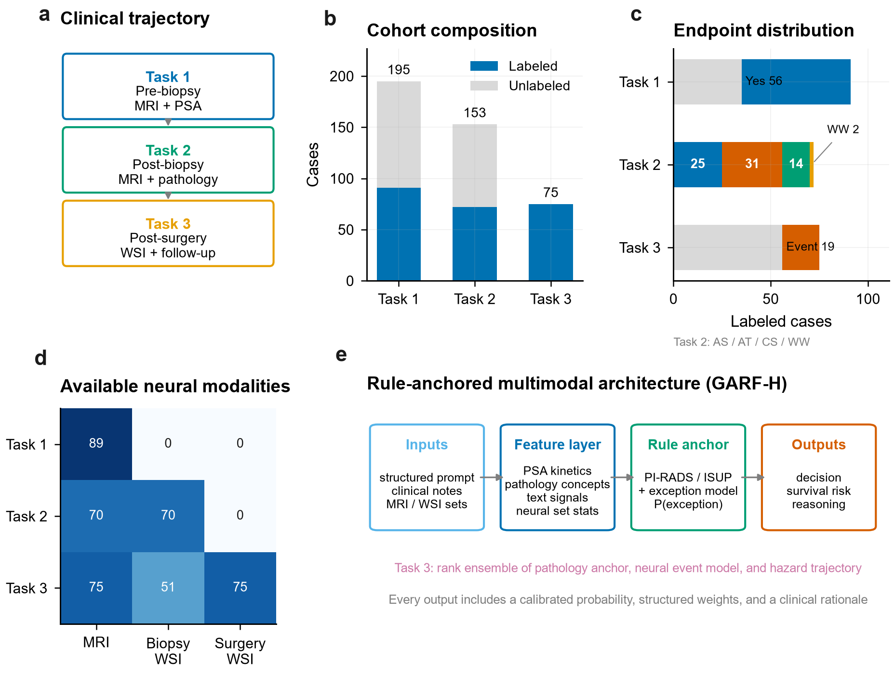

# CHIMERA-Agent

**Guideline-Anchored Multimodal Decision Agent for Prostate Cancer Care**

[]()
[]()
[](LICENSE)

CHIMERA-Agent is a research prototype for three linked prostate-cancer decision tasks:

1. **Task 1 — biopsy decision** before histopathological confirmation;
2. **Task 2 — post-biopsy management** (active surveillance, active treatment, continued surveillance, watchful waiting);
3. **Task 3 — biochemical recurrence risk** after radical prostatectomy.

The core model, **GARF-H** (Guideline-Anchored Residual Fusion – Hybrid), keeps clinical guidelines as a strong prior, learns only their exceptions, fuses pathology and neural evidence in rank space for survival, and generates structured clinical reasoning.

> **Research use only.** This repository is not a medical device and must not be used for clinical decisions without prospective validation, regulatory review, and clinician oversight.

---

## Highlights

- **Guideline anchoring rather than replacement.** On small labeled cohorts, classifiers trained from scratch are worse than the PI-RADS/ISUP rule. GARF-H keeps the guideline as the prior and learns the *residual*: a conservative exception layer for Task 1, and a logit-space blend of the rule with a seed-averaged ExtraTrees ensemble for Task 2.
- **Rank-robust survival fusion.** The pathology risk score is heavy-tailed (PSA up to 190 ng/mL). GARF-H fuses pathology risk, a neural event model, and a discrete-time hazard trajectory in rank space, improving the OOF C-index from ~0.81 to **0.917**.
- **Supervised structured reasoning.** Confidence, ordinal variable weights, tool-reveal order, and a case-specific rationale are learned from reference traces instead of being hard-coded.
- **One model family across the clinical continuum.** The same design principles — anchor, residual, rank fusion, structured reasoning — apply to pre-biopsy, post-biopsy, and post-surgery decisions.
- **Compact and deterministic.** No API dependency, no JSON-format failures, and reproducible outputs.



---

## Results

### Full out-of-fold evaluation (5-fold × 4 repeats)

| Task | Primary metric | Result | Secondary metrics |
|---|---|---:|---|
| Task 1 — biopsy | Positive F1 | **0.825** (95% CI 0.750–0.892) | Accuracy 0.758 (0.670–0.846); ROC AUC 0.827 (0.733–0.909) |
| Task 2 — management | Weighted F1 | **0.861** (0.773–0.944) | Accuracy 0.861 (0.778–0.944); macro F1 0.785 |
| Task 3 — recurrence | Harrell C-index | **0.917** (0.872–0.958) | 19 events / 56 censored |

Reasoning and case scores:

| Task | Reasoning composite | Case score |
|---|---:|---:|
| Task 1 | **0.667** | **0.786** |
| Task 2 | **0.636** | **0.805** |
| Task 3 | — | **0.917** |

Task 3 component ablation (C-index): pathology 0.807; neural event 0.837; hazard 0.832; pathology + event 0.890; full component blend 0.898; **final rank ensemble 0.917**; Cox PH 0.822; clinical-only hybrid 0.819.

### Supporting benchmark (same 40-case subset per task)

| Task | GARF-H | Guideline/anchor | Best traditional ML/DL | DeepSeek-Flash | GLM-5.3 |
|---|---:|---:|---:|---:|---:|
| 1 — positive F1 | **0.906** | 0.814 | 0.766 (MLP) | 0.781 (40/40) | 0.794 (40/40) |
| 2 — weighted F1 | **0.896** | 0.875 | 0.852 (random forest) | 0.503 (40/40) | 0.369 (40/40) |
| 3 — C-index | **0.875** | 0.815 (pathology) | 0.781 (Cox PH) | 0.777 (40/40) | 0.757 (40/40) |

GARF-H leads on all three tasks. On Task 2 it blends the rule prior with a seed-averaged ExtraTrees ensemble, improving weighted F1 over the rule (0.896 vs. 0.875) while also producing structured reasoning (composite 0.638 vs. 0.368/0.409 for the LLM agents). The benchmark is **supporting evidence**, not a leaderboard. See [docs/BENCHMARK.md](docs/BENCHMARK.md).

---

## Repository layout

```text
chimera/
  data/                 dataset loading and case schema
  features/             clinical, radiology-text, pathology, text and neural parsing
  models/               guideline rules, rule-anchored exception model, Cox PH, hybrid survival
  evaluation/           stratified repeated CV, bootstrap CIs, benchmark harness, local evaluator
  reasoning/            supervised confidence / weights / tool trace / rationale generation
  agents/               DeepSeek and GLM API agents plus comparison harness
scripts/
  run_pipeline.py       end-to-end evaluation + submission + figures
  run_local_eval.py     repeated stratified CV and OOF metrics
  create_submission.py  write task1/task2/task3 outputs
  make_report_figures.py
  run_benchmark.py      traditional ML/DL + proposed model
  run_llm_benchmark.py  DeepSeek / GLM agents
  combine_benchmark_tables.py
  make_benchmark_figure.py
configs/                experiment configuration
tests/                  regression tests
docs/                   Chinese project report, benchmark, figure captions, changelog
results/
  figures/              Figures 1–6 (PNG/PDF/SVG)
  tables/               benchmark and evaluation tables
  local_eval.json
  audit.json
data/                   expected dataset layout (raw data not included)
archive/legacy_scripts/  earlier plotting/analysis scripts, kept for history
```

---

## Data

Raw data are **not** included in this repository. The training release is expected as:

```text
<data-root>/
  task1/<case_id>/{structured-prompt, clinical-data, neural-representations, decision, reasoning}.json
  task2/<case_id>/...
  task3/<case_id>/...
```

Cohort sizes in the released labeled data:

| Task | Total | Labeled | Unlabeled | Label distribution |
|---|---:|---:|---:|---|
| Task 1 | 195 | 91 | 104 | yes 56 / no 35 |
| Task 2 | 153 | 72 | 81 | AS 25 / AT 31 / CS 14 / WW 2 |
| Task 3 | 75 | 75 | 0 | event 19 / censored 56 |

See [data/README.md](data/README.md) for the exact file names and fields. The data are pseudo/anonymized; do not redistribute without permission.

`results/local_eval.json` contains pseudo-case-level out-of-fold predictions and generated rationales for reproducibility; it is not raw input data and can be deleted if a repo should contain aggregate metrics only.

---

## Installation

```bash
git clone https://github.com/<your-org>/chimera-agent.git
cd chimera-agent
python -m pip install -r requirements.txt
```

Optional, for the GLM SDK path:

```bash
python -m pip install zai
```

The code was developed with Python 3.10+, NumPy, pandas, scikit-learn, SciPy and Matplotlib.

---

## Quickstart

### Full evaluation

```bash
python scripts/run_local_eval.py \
  --data-root /path/to/train_release \
  --output results/local_eval.json \
  --neural --splits 5 --repeats 4
```

### Submission for all cases

```bash
python scripts/create_submission.py \
  --data-root /path/to/train_release \
  --output results/submission \
  --all-cases
```

### Figures

```bash
python scripts/make_report_figures.py \
  --data-root /path/to/train_release \
  --eval results/local_eval.json \
  --output-dir results/figures
```

### One-command pipeline

```bash
python scripts/run_pipeline.py \
  --data-root /path/to/train_release \
  --output-dir results/pipeline \
  --splits 5 --repeats 4
```

Outputs: `local_eval.json`, `submission/`, `figures/`.

---

## Evaluation protocol

- **Repeated stratified K-fold**: 5 folds × 4 repeats; Task 1/2 stratified by label, Task 3 by event.
- **Out-of-fold predictions**: every prediction comes from a model that never saw that case.
- **Bootstrap 95% CIs** for accuracy, F1, AUC and C-index.
- **Rare classes**: Task 2 has only two watchful-waiting cases; stratified folds keep them in training. Per-class metrics and macro F1 are reported alongside weighted F1.
- **Reasoning**: local surrogate scores for confidence, variable weights, tool sequence and rationale. The official evaluator may use an LLM judge; see [docs/PROJECT_REPORT_CN.md](docs/PROJECT_REPORT_CN.md).

---

## Benchmark

### Traditional ML/DL + proposed model

```bash
python scripts/run_benchmark.py \
  --data-root /path/to/train_release \
  --output-dir results/benchmark \
  --n-per-task 40 --splits 5 --repeats 4
```

Baselines: logistic regression, random forest, gradient boosting, MLP; for Task 3, Cox PH, random-forest event, MLP event and ExtraTrees survival.

### LLM agents

API keys are read from environment variables or prompted securely; they are never written to disk.

```bash
# Interactive: prompts for the keys
python scripts/run_llm_benchmark.py \
  --data-root /path/to/train_release \
  --models deepseek-flash glm-5.3 \
  --interactive-keys

# Or set the environment variables
export DEEPSEEK_API_KEY="..."
export ZHIPU_API_KEY="..."
python scripts/run_llm_benchmark.py \
  --data-root /path/to/train_release \
  --models deepseek-flash glm-5.3
```

Then rebuild the combined table and Figure 6:

```bash
python scripts/combine_benchmark_tables.py   --benchmark results/benchmark/benchmark_results.json   --llm results/benchmark/llm_results.json   --output results/benchmark/benchmark_combined

python scripts/make_benchmark_figure.py   --benchmark results/benchmark/benchmark_results.json   --llm results/benchmark/llm_results.json   --output-dir results/benchmark/figures
```

The pre-generated copies shipped with this repository are in `results/tables/` and `results/figures/`; to rebuild from those, pass `results/tables/benchmark_results.json`, `results/tables/llm_results.json`, and `--output-dir results/figures`.

The LLM arm is descriptive: the same subset and two-stage prompt are used for every model, and the study is not powered to rank APIs. GLM-5.3 initially lost Task 1/2 cases to truncated JSON; the released client validates cached responses, uses a 16000-token budget, parses only complete objects, normalises decisions and makes one repair call, and now completes 40/40 on all three tasks. See [docs/BENCHMARK.md](docs/BENCHMARK.md).

---

## Figures

| Figure | File |
|---|---|
| Figure 1 — cohort and architecture | [PNG](results/figures/fig1_cohort_and_architecture.png) · [PDF](results/figures/fig1_cohort_and_architecture.pdf) |
| Figure 2 — Task 1 | [PNG](results/figures/fig2_task1_biopsy.png) · [PDF](results/figures/fig2_task1_biopsy.pdf) |
| Figure 3 — Task 2 | [PNG](results/figures/fig3_task2_management.png) · [PDF](results/figures/fig3_task2_management.pdf) |
| Figure 4 — Task 3 | [PNG](results/figures/fig4_task3_recurrence.png) · [PDF](results/figures/fig4_task3_recurrence.pdf) |
| Figure 5 — comparison and reasoning | [PNG](results/figures/fig5_model_comparison.png) · [PDF](results/figures/fig5_model_comparison.pdf) |
| Figure 6 — benchmark | [PNG](results/figures/fig6_benchmark_comparison.png) · [PDF](results/figures/fig6_benchmark_comparison.pdf) |

Panel-by-panel captions: [docs/FIGURE_CAPTIONS.md](docs/FIGURE_CAPTIONS.md).

---

## Tests

```bash
python -m pytest -q tests
```

The current suite covers the pathology parser, C-index, evaluator, stratified folds, rule-anchored exception learning, Cox direction recovery, hybrid survival output validity, and supervised reasoning structure.

---

## Security and privacy

- API keys are **never** stored in the repository. Use environment variables or `--interactive-keys`, which uses `getpass`.
- Raw patient data are not included. Do not upload the training release or generated submissions to a public repository without confirming the data-use agreement.
- The case IDs and labels in this release are pseudo/anonymized, but they may still be subject to the original data-use terms.
- Rotate any API key that has been pasted into a chat or shared in plain text.

---

## Documentation

- **中文项目报告（推荐阅读）**: [docs/PROJECT_REPORT_CN.md](docs/PROJECT_REPORT_CN.md)
- Paper narrative and figure plan: [docs/PAPER_NARRATIVE.md](docs/PAPER_NARRATIVE.md)
- Benchmark protocol/results: [docs/BENCHMARK.md](docs/BENCHMARK.md)
- Figure captions: [docs/FIGURE_CAPTIONS.md](docs/FIGURE_CAPTIONS.md)
- Legacy analysis workflow: [docs/archive/ANALYSIS_WORKFLOW.md](docs/archive/ANALYSIS_WORKFLOW.md)

---

## Citation

If you use this code or the benchmark protocol, please cite:

```bibtex
@software{chimera_agent_2026,
  title  = {CHIMERA-Agent: Guideline-Anchored Multimodal Decision Agent for Prostate Cancer Care},
  author = {CHIMERA-Agent contributors},
  year   = {2026},
  url    = {https://github.com/<your-org>/chimera-agent}
}
```

A `CITATION.cff` is included for GitHub's citation feature.

---

## License

MIT License. See [LICENSE](LICENSE). The license covers the code, not the data; data use is governed by the original release agreement.

---

## Acknowledgements

This project builds on open-source tools from the Python, NumPy, pandas, scikit-learn, SciPy and Matplotlib communities. The clinical task design follows the EAU/NCCN prostate-cancer guideline concepts; the implementation is independent and intended for research.
