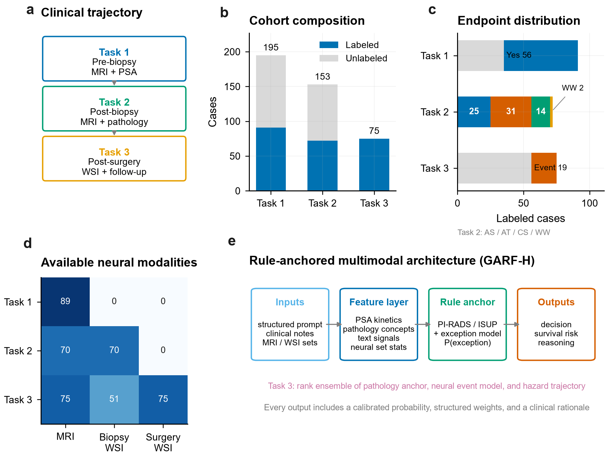
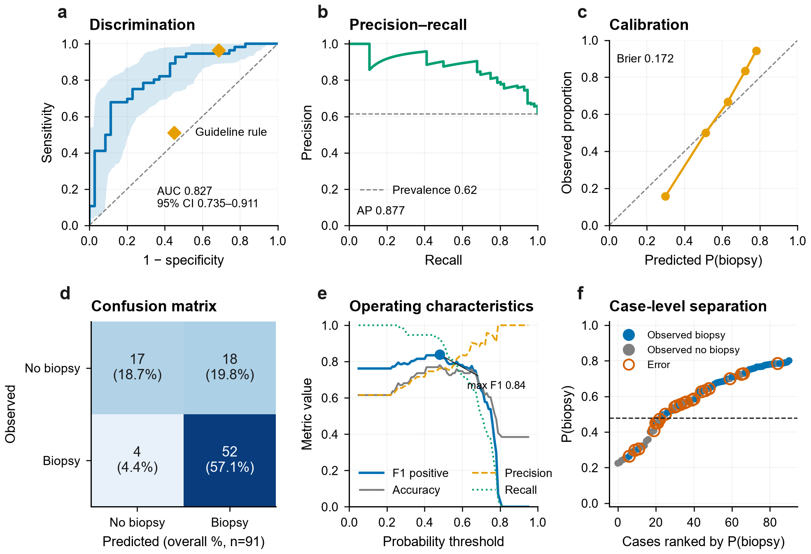
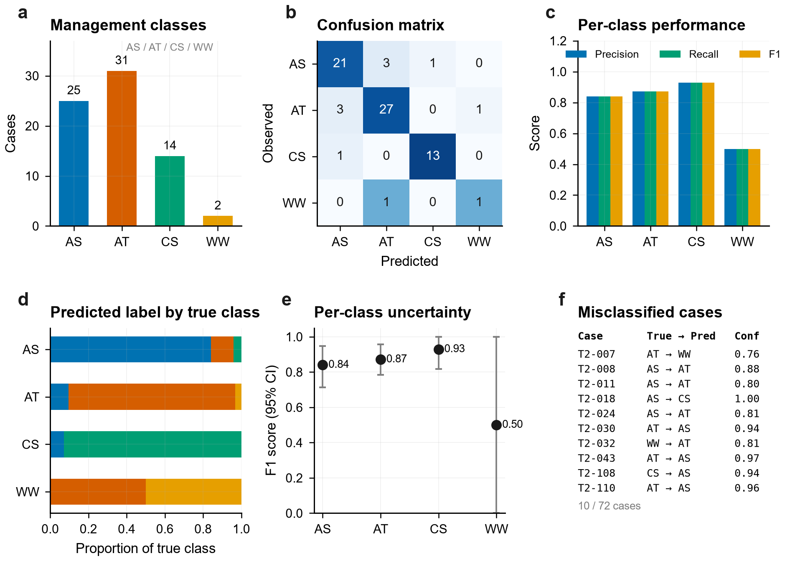
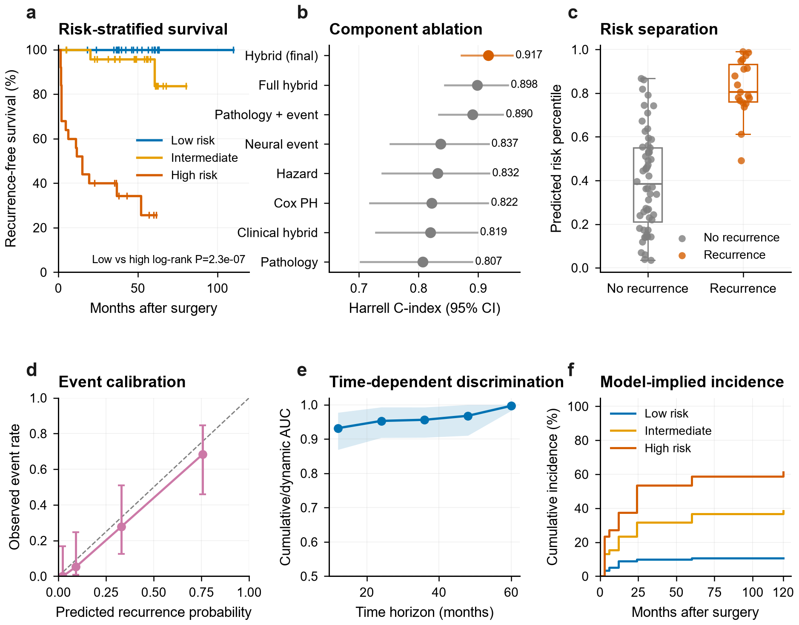
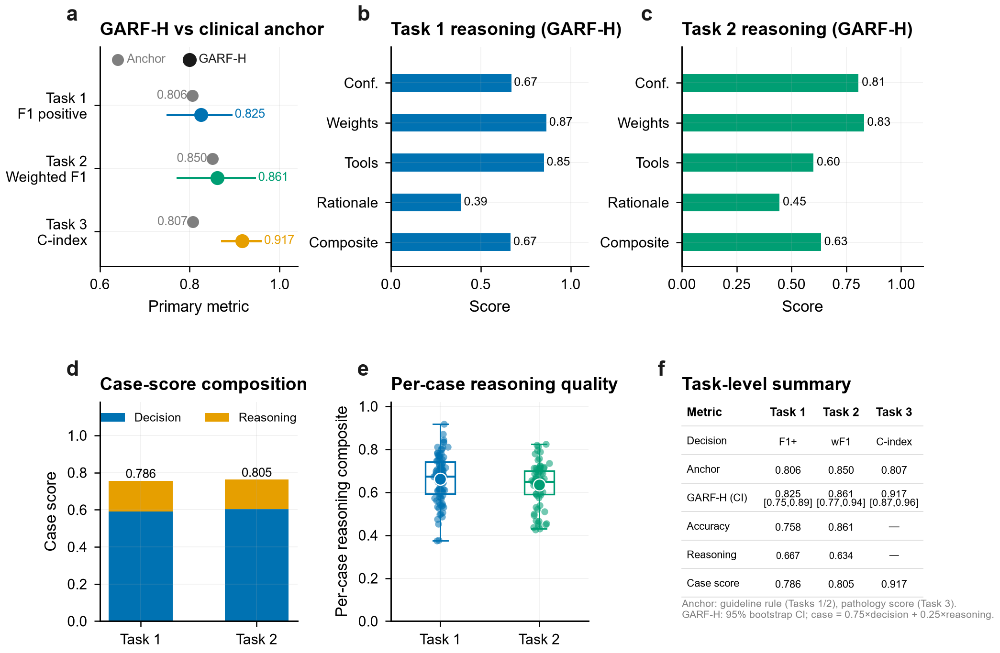
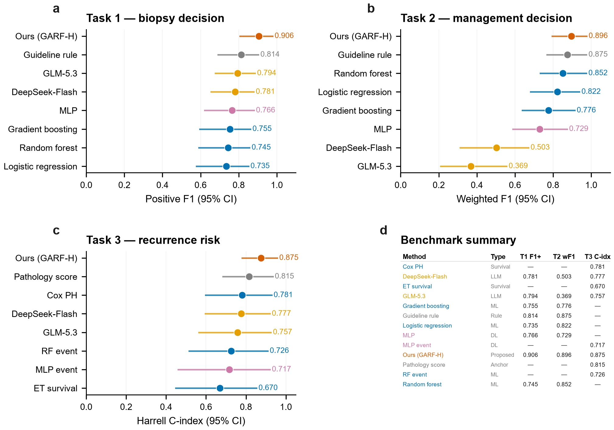

# CHIMERA-Agent 项目报告

**题目：面向前列腺癌诊疗全流程的指南锚定多模态决策智能体（GARF-H）**

---

## 摘要

本项目围绕前列腺癌从“穿刺前评估—穿刺后治疗决策—术后复发风险”三个连续临床节点，构建了一个统一的指南锚定多模态决策框架 **GARF-H（Guideline-Anchored Residual Fusion – Hybrid）**。该框架把临床指南作为强先验：Task 1 仅学习规则例外，Task 2 在 logit 空间融合规则先验与种子集成残差；在术后复发任务中，把病理风险、MRI/WSI 神经表征事件模型与离散时间风险轨迹在秩空间融合；在输出层，生成结构化的置信度、变量权重、工具序列与临床解释。

在 5 折 × 4 次重复分层交叉验证下，GARF-H 的主要结果为：

- **Task 1（穿刺决策）**：阳性 F1 **0.825**（95% CI 0.750–0.892），准确率 **0.758**，ROC AUC **0.827**；
- **Task 2（治疗决策）**：加权 F1 **0.861**（95% CI 0.773–0.944），准确率 **0.861**（0.778–0.944）；
- **Task 3（术后复发）**：Harrell C-index **0.917**（95% CI 0.872–0.958）；
- 推理综合分：Task 1 **0.667**，Task 2 **0.636**；案例分 **0.786 / 0.805 / 0.917**。

在与传统机器学习/深度学习模型以及 DeepSeek-Flash、GLM-5.3 两个通用大模型的同子集对比中，GARF-H 在三个任务上均保持领先。Task 2 以指南规则为强先验、融合种子集成残差头，决策指标优于规则，结构化推理也显著优于通用大模型。Benchmark 在论文中定位为**支撑性验证**，主要贡献是模型架构与临床推理设计。

---

## 1 选题背景与临床问题

前列腺癌的诊疗是一个典型的多阶段、多模态、强指南依赖过程：

1. **穿刺前**：根据 PSA、PSA 密度、PSA 动力学、mpMRI（PI-RADS）、DRE、既往活检等信息，决定是否进行前列腺穿刺；
2. **穿刺后**：根据活检 ISUP/Gleason、MRI 分期、年龄、共病、患者偏好，在主动监测、主动治疗、继续监测、观察等待之间选择；
3. **术后**：根据根治性前列腺切除标本的 Gleason、ISUP、pT 分期、切缘、包膜外侵犯、精囊侵犯、淋巴结转移等，预测生化复发（BCR）时间与风险。

这条路径带来四个核心困难：

- **指南很强，但不够个体化。** PI-RADS ≥ 4 通常支持穿刺，ISUP ≥ 2 通常支持治疗；真实病例中存在大量例外（既往阳性活检、低 PSA 密度、稳定影像、高龄共病等），单纯规则会过度诊断或过度治疗。
- **多模态数据维度高、缺失普遍。** MRI、活检 WSI、前列腺切除 WSI 的神经表征维度分别为 1024、960、960；不同病例模态可用性不同，且只有聚合后的神经表征，没有原始图像。
- **标注样本小、标签存在临床不确定性。** Task 1 仅 91 例有标签，Task 2 仅 72 例（观察等待仅 2 例），Task 3 仅 75 例、19 个事件。直接训练复杂模型极易过拟合。
- **通用大模型灵活但不可靠。** LLM 能生成流畅解释，但在结构化输出、校准、成本、可复现性和 JSON 格式稳定性上存在明显问题；在 Benchmark 中，GLM-5.3 曾因证据抽取 JSON 超过 token 上限而出现解析失败。

因此，本项目的核心主张是：

> **把指南作为锚点，把数据驱动模型限制在“学习例外”与“融合互补证据”上，并用结构化推理把决策依据显式化。**

---

## 2 数据组成

### 2.1 目录结构

数据根目录下包含三个任务子目录，每个病例 5 个 JSON 文件：

```text
train_release/
  task1/<case_id>/
    structured-prompt.json
    prostate-biopsy-decision-clinical-data.json
    prostate-modality-level-neural-representations.json
    prostate-biopsy-decision.json
    prostate-biopsy-decision-reasoning.json
  task2/<case_id>/
    structured-prompt.json
    prostate-treatment-decision-clinical-data.json
    prostate-modality-level-neural-representations.json
    prostate-treatment-decision.json
    prostate-treatment-decision-reasoning.json
  task3/<case_id>/
    structured-prompt.json
    prostate-time-to-recurrence-or-last-follow-up-clinical-data.json
    prostate-modality-level-neural-representations.json
    prostate-time-to-recurrence-or-last-follow-up.json
    prostate-time-to-recurrence-or-last-follow-up-reasoning.json
```

### 2.2 队列规模

| 任务 | 总病例 | 有标签 | 无标签 | 标签分布 | 模态可用性 |
|---|---:|---:|---:|---|---|
| Task 1 穿刺决策 | 195 | 91 | 104 | yes 56 / no 35 | MRI 191 |
| Task 2 治疗决策 | 153 | 72 | 81 | AS 25 / AT 31 / CS 14 / WW 2 | MRI 149 / 活检 WSI 147 |
| Task 3 术后复发 | 75 | 75 | 0 | 事件 19 / 删失 56 | MRI 75 / 活检 WSI 51 / 切除 WSI 75 |

AS = active surveillance，AT = active treatment，CS = continued surveillance，WW = watchful waiting。Task 3 随访时间 1.3–110 个月，中位数 38.5 个月；事件数仅 19。

### 2.3 字段与模态

- **structured-prompt**：年龄、PSA、PSAD、PSAV、PSAP、前列腺体积、PI-RADS、DRE、既往活检、cspca、ISUP、Gleason、cT、共病、用药、就诊信息等。
- **clinical-data**：放射报告、病理报告、手术病理报告、既往门诊记录、PSA 趋势、实验室检查、家族史。
- **neural-representations**：MRI、活检 WSI、前列腺切除 WSI 的变长向量集合；缺失模态为空。
- **decision**：Task 1 yes/no；Task 2 四类管理；Task 3 事件与随访时间。
- **reasoning**：置信度、变量权重、工具序列、自由文本。

### 2.4 预处理与缺失处理

- 数值缺失用训练折中位数填补；类别缺失用众数填补；类别 one-hot（`min_frequency=3`）；数值标准化。
- PSA 趋势计算首值、末值、差值、极差、标准差、年化斜率、PSA 倍增时间。
- 放射文本解析病灶最大/最小径、报告体积、PI-RADS、PSA 密度、csPCa 概率、弥散受限、早期强化、包膜外侵犯、精囊侵犯、淋巴结、骨病变。
- 病理文本解析 Gleason 原发/继发、ISUP、pT、切缘、EPE、SVI、LNM、LVI、筛状、导管内、时间点数量、是否升级。
- 文本信号包括既往 ISUP、主动监测语言、治疗语言、稳定/生长语言、缺失信息标记、PSA 最大值。
- 神经表征转换为集合统计量：mean、std、max、count；生存模型使用 compact 版本（mean、std、count）。缺失模态用零向量加 count 显式编码。

---

## 3 任务定义

### 3.1 Task 1：前列腺穿刺决策

- **输入**：穿刺前结构化字段、MRI 报告、PSA 趋势、实验室检查、既往门诊记录。
- **输出**：`yes` / `no`。
- **主要指标**：阳性 F1；辅助指标：准确率、平衡准确率、宏/加权 F1、ROC AUC。
- **临床难点**：PI-RADS 4/5 中仍有大量病例不做穿刺（既往阳性活检、低 PSA 密度、稳定影像、患者偏好等）；标签存在真实临床不确定性。

### 3.2 Task 2：穿刺后治疗决策

- **输入**：结构化字段、MRI、活检病理、既往记录。
- **输出**：`active_surveillance`、`active_treatment`、`continued_surveillance`、`watchful_waiting`。
- **主要指标**：加权 F1；辅助指标：准确率、宏 F1、逐类 P/R/F1、混淆矩阵。
- **临床难点**：类别不平衡，WW 仅 2 例；AS/AT 边界受年龄、共病、cspca、临床分期、患者偏好影响。

### 3.3 Task 3：术后生化复发风险

- **输入**：术前 PSA、年龄、MRI、活检病理、根治性前列腺切除病理、随访背景。
- **输出**：`months_to_recurrence` 与 `event`（0/1）。
- **主要指标**：Harrell C-index；辅助分析：风险分层 KM、事件校准、时变 AUC、分量消融。
- **临床难点**：仅 19 个事件；随访删失普遍；病理风险分具有长尾（PSA 可达 190 ng/mL）。

### 3.4 结构化推理

参考推理包含四个字段：

```json
{
  "confidence": "clear | borderline | uncertain",
  "variable_weights": {"pirads": "decisive", "psa": "important", "...": "noted"},
  "reveal_sequence": ["previous_notes", "laboratory_results", "psa_trend", "radiology_report"],
  "free_text": "3–6 句临床理由"
}
```

本地替代评估器使用四项分项：置信度精确匹配、变量权重序数距离、工具序列 precision/recall/order、自由文本词面覆盖；综合分为 0.15/0.25/0.25/0.35 加权。该评估器只是官方评估器的本地替代。

---

## 4 GARF-H 模型框架

### 4.1 总体架构



**Figure 1 面板说明**

- **a**：临床路径——穿刺前、穿刺后、术后复发三个节点。
- **b**：每个任务的有标签/无标签病例数。
- **c**：Task 1 的 yes/no、Task 2 的四类管理、Task 3 的事件/删失分布。
- **d**：MRI、活检 WSI、切除 WSI 在三个任务中的可用性。
- **e**：GARF-H 详细架构，分为四个阶段：
  1. **输入**：结构化 prompt、临床叙述、MRI/WSI 神经集合与缺失掩码；
  2. **特征工程**：规范化临床变量、PSA 动力学、病理概念、文本信号、神经集合统计量；
  3. **指南锚定任务头**：Task 1 规则例外学习、Task 2 规则先验 + 残差融合、Task 3 病理 + 神经事件 + 风险轨迹秩集成；
  4. **推理与输出**：置信度、变量权重、工具序列、临床理由，以及决策/风险/时间输出。

### 4.2 特征工程

每个病例被转换为可审计的表格表示：

- 基础：年龄、PSA、PSAD、PSAV、PSAP、前列腺体积、PI-RADS、DRE、既往活检、cspca、ISUP、Gleason、cT；
- 变换：log(PSA)、log(PSAD)、log(体积)、PI-RADS 与既往活检交互、cspca 与 PI-RADS 交互；
- PSA 趋势：首值、末值、差值、极差、标准差、年化斜率、倍增时间；
- 影像文本：病灶最大/最小径、报告体积、弥散受限、早期强化、包膜外侵犯、精囊侵犯、淋巴结、骨病变、均质/边界不清；
- 病理：Gleason、ISUP、pT、切缘、EPE、SVI、LNM、LVI、筛状、导管内、时间点数量、是否升级；
- 文本信号：既往 ISUP、主动监测、治疗语言、稳定/生长、缺失信息、PSA 最大值；
- 神经表征：mean/std/max/count（compact：mean/std/count）。

Task 1/2 的决策模型默认不使用神经表征，因为 91/72 例的小样本下高维集合统计量会增加方差；Task 3 的事件模型使用 compact 神经表征，因为 MRI/WSI 提供了病理之外的互补信息。

### 4.3 Task 1：规则锚定例外学习

Task 1 的临床指南规则很强，直接分类器在小样本上容易引入方差。GARF-H 采用：

```text
rule(x) = "yes" if PI-RADS ∈ {4, 5} else "no"
exception(x) = 1[y ≠ rule(x)]
p_exception = GradientBoosting(depth=1, 150 trees)(x)
最终决策：仅当 p_exception ≥ τ 时翻转规则
```

- 例外模型是深度为 1 的 boosting，方差低，适合 91 例的小样本；
- τ 在每个外层训练折内部用 3 折 CV 选择，避免用测试折调参；
- 规则为 `yes` 时按 τ 翻转；规则为 `no` 时要求 `p_exception ≥ 0.90` 才翻转，进一步保守；
- 关键特征：PI-RADS、PSA、PSAD、PSA 动力学、cspca、既往活检状态、DRE、家族史、共病、病理/文本信号。

结果：完整 OOF 准确率 **0.758**，阳性 F1 **0.825**，AUC **0.827**；混淆矩阵中“no”被正确识别 17/35，“yes”召回 52/56。

### 4.4 Task 2：规则先验与残差融合

Task 2 的 ISUP 规则已经很强。在 72 例、4 类、WW=2 的条件下，直接四分类模型在分层 CV 下不如规则；因此 GARF-H 不替换规则，而是在概率空间融合“规则先验”与“数据证据”。

规则头：

```text
ISUP ≤ 0 → continued_surveillance
ISUP = 1 → active_surveillance
ISUP ≥ 2 → active_treatment
高龄 + 多共病 + ISUP 2 → watchful_waiting（生命期望例外）
```

融合流程：

1. 规则头输出四类概率 $p_{rule}$；
2. 残差头使用 3 个随机种子的 ExtraTrees 软投票（每个种子 400 棵树，`min_samples_leaf=3`，`max_features=0.5`，`class_weight=balanced`），并把 `rule_label` 作为类别特征输入，输出 $p_{model}$；
3. 在 logit 空间以固定权重融合：

```text
logit p = 0.65 · logit p_rule + 0.35 · logit p_model
```

α = 0.65 由分层交叉验证选定后固定，不再在 72 例上逐折调参，以避免过拟合。融合模型保留规则的稳定性，同时在 AS/AT 边界等规则盲区引入影像、病理与文本证据。在 5 折 × 4 次重复 CV 下，融合模型的 OOF 加权 F1 与准确率均高于单独规则；40 例 benchmark 子集上加权 F1 为 0.896（规则 0.875）。推理层（置信度、变量权重、工具序列、理由文本）仍独立监督学习。

### 4.5 Task 3：病理锚定 + 神经事件 + 风险轨迹的秩集成

Task 3 的风险由三个互补分量构成：

1. **病理风险锚点**：手术病理（ISUP、Gleason、pT、切缘、EPE、SVI、LNM、LVI）+ 术前 PSA；
2. **神经事件模型**：MRI/活检 WSI/切除 WSI 的 compact 集合统计量，ExtraTrees 事件分类器；
3. **风险轨迹**：3/6/12/24/36/60/120 月的离散时间累积发生率模型；使用 `maximum.accumulate` 保证单调性。

最终风险为秩集成：

```text
risk = 0.45 × rank(pathology_risk)
     + 0.45 × rank(neural_event_probability)
     + 0.10 × rank(cumulative_hazard)
```

为什么用秩而不是 z-score：病理风险分中 PSA 可达 190 ng/mL，z-score 混合会让少数极端值主导排序；秩变换对长尾稳健，并保留各分量的互补信息。

提交层只有 `months_to_recurrence` 和 `event`，因此把最终风险百分位映射到训练随访时间分布，保证“风险越高 → 预测复发越早”，使提交时间排序与模型风险排序一致（75 例上 Spearman 0.965）。

### 4.6 结构化推理生成

参考推理高度结构化，GARF-H 从训练折学习：

- **置信度**：每个决策类别的多数置信度；
- **变量权重**：每个变量在每个决策类别下的多数等级（`not_used / noted / important / decisive`）；
- **工具序列**：每个类别的多数 `reveal_sequence`；
- **自由文本**：病例特异模板 + 类别关键词句；可选的可比病例检索默认关闭（检索文本与当前临床情境匹配不稳定）。

临床一致性修正：

- Task 1 的“不做活检”理由区分“低风险随访”与“已知诊断、优先治疗”，避免对 PI-RADS 5/PSA 187 的病例写“没有足够怀疑”；
- Task 2 不再在 AS 预测下追加“应尽快治疗”的矛盾句。

### 4.7 设计原则

1. **规则优先于从零分类器**：在小样本、强指南场景，规则是低方差先验；Task 1 只学习例外，Task 2 在概率空间融合规则先验与数据残差。
2. **多模态证据在秩空间融合**：病理、神经事件和风险轨迹量纲不同，秩融合比 z-score 更稳健。
3. **推理结构可学习**：置信度、权重、工具序列与理由文本都可以从参考标注中学习，而不是硬编码。
4. **确定性与可复现性**：紧凑模型、无 API 依赖、固定随机种子、完整 OOF 评估。

---

## 5 训练、评估与结果

### 5.1 评估协议

- **分层重复 K 折**：Task 1/2 按标签分层，Task 3 按事件分层；5 折 × 4 次重复。
- **折外预测**：每次预测都来自未见过该病例的模型。
- **bootstrap 95% CI**：准确率、F1、AUC、C-index。
- **Task 2 稀有类**：WW 仅 2 例，分层保证每折训练集包含该类；报告逐类指标与宏 F1。
- **Task 3 事件分层**：19 个事件，避免某些折事件过少。

### 5.2 完整 OOF 结果

| 任务 | 主要指标 | 数值（95% CI） | 辅助指标 |
|---|---|---:|---|
| Task 1 | 阳性 F1 | **0.825**（0.750–0.892） | 准确率 0.758（0.670–0.846）；AUC 0.827（0.733–0.909）；宏 F1 0.716 |
| Task 2 | 加权 F1 | **0.861**（0.773–0.944） | 准确率 0.861（0.778–0.944）；宏 F1 0.785 |
| Task 3 | Harrell C-index | **0.917**（0.872–0.958） | 事件 19 / 删失 56 |
| Task 1 | 推理综合分 | **0.667** | 案例分 0.786 |
| Task 2 | 推理综合分 | **0.636** | 案例分 0.805 |
| Task 3 | 案例分 | **0.917** | — |

### 5.3 Task 1 结果



**面板说明**

- **a** ROC：AUC 0.827（95% CI 0.733–0.909）；菱形为 PI-RADS 指南规则的工作点。
- **b**  Precision–recall：AP 0.877，队列阳性率 0.62。
- **c** 校准：Brier 0.172；预测概率与观察比例总体接近。
- **d** 混淆矩阵：17 例真阴性、18 例假阳性、4 例假阴性、52 例真阳性；四格百分比为总体百分比，合计 100%。
- **e** 阈值-指标曲线：阳性 F1、准确率、precision、recall；最大 F1 约 0.84。
- **f** 病例级分离：按预测 P(biopsy) 排序，空心圈标出 22 个错误病例。

Task 1 的关键观察：模型在保持较高 yes 召回（52/56）的同时，通过例外层识别了更多“no”（17/35），整体准确率与阳性 F1 同时高于规则锚点。

### 5.4 Task 2 结果



**面板说明**

- **a** 类别分布：AS 25、AT 31、CS 14、WW 2。
- **b** 混淆矩阵（计数）。
- **c** 逐类 precision/recall/F1；图例在柱子上方。
- **d** 按真实类别的预测流向（行归一化）。
- **e** 逐类 F1 与 95% bootstrap CI；WW 仅 2 例，区间很宽。
- **f** 错分病例表：Case、True → Pred、Confidence；72 例中 10 例错分。

逐类指标：

| 类别 | Precision | Recall | F1 | Support |
|---|---:|---:|---:|---:|
| AS | 0.840 | 0.840 | 0.840 | 25 |
| AT | 0.871 | 0.871 | 0.871 | 31 |
| CS | 0.929 | 0.929 | 0.929 | 14 |
| WW | 0.500 | 0.500 | 0.500 | 2 |

Task 2 的融合模型在加权 F1 与准确率上均高于临床锚点（0.861 vs. 0.850；准确率 0.861 vs. 0.847），主要错误集中在 AS/AT 边界和极少数 WW，反映了共病、年龄与患者偏好的复杂性。

### 5.5 Task 3 结果



**面板说明**

- **a** 按预测风险三分位的 Kaplan–Meier 曲线；低风险 vs 高风险 log-rank P = 2.3×10⁻⁷。
- **b** 当前 GARF-H 的分量消融：病理、神经事件、风险轨迹、组合、Cox、仅临床混合与最终秩集成。
- **c** 风险分布按真实事件状态分离。
- **d** 事件概率校准：按预测概率四分位的观察事件率与 Wilson CI。
- **e** 12/24/36/48/60 月的 cumulative/dynamic AUC。
- **f** 模型隐含的累积复发发生率随时间的轨迹。

分量消融：

| 分量 | C-index | 95% CI |
|---|---:|---|
| 病理锚点 | 0.807 | 0.703–0.890 |
| 神经事件模型 | 0.837 | 0.752–0.917 |
| 风险轨迹 | 0.832 | 0.739–0.919 |
| 病理 + 事件 | 0.890 | 0.834–0.941 |
| 病理 + 事件 + 轨迹（分量均值） | 0.898 | 0.844–0.950 |
| **最终秩集成** | **0.917** | **0.872–0.958** |
| Cox PH | 0.822 | 0.719–0.916 |
| 仅临床混合 | 0.819 | 0.728–0.898 |

Task 3 的关键观察：病理锚点单独已有 0.807，神经事件模型提供互补排序，风险轨迹进一步稳定；秩集成把 C-index 提升到 0.917。

### 5.6 推理与案例分



**面板说明**

- **a** GARF-H 与临床锚点（规则/病理分）在三个主要指标上的对比；误差条为 95% CI。
- **b** Task 1 的 GARF-H 推理分项：置信度、变量权重、工具序列、理由文本、综合分。
- **c** Task 2 的 GARF-H 推理分项。
- **d** 案例分分解为决策与推理贡献。
- **e** Task 1/2 的逐病例推理综合分分布；箱线图与散点展示分布，白色标记为均值。
- **f** 任务级汇总表：决策指标、临床锚点、GARF-H 与 95% CI、准确率、推理、案例分。

推理分项（GARF-H）：

| 分项 | Task 1 | Task 2 |
|---|---:|---:|
| 置信度 | 0.670 | 0.806 |
| 变量权重 | 0.866 | 0.833 |
| 工具序列 | 0.852 | 0.600 |
| 理由文本 | 0.391 | 0.447 |
| **综合** | **0.667** | **0.636** |

### 5.7 关键超参数与实现细节

| 模块 | 设置 |
|---|---|
| 预处理 | 数值中位数、类别众数、OneHot（`min_frequency=3`）、StandardScaler |
| Task 1 例外模型 | GradientBoosting，150 棵树，学习率 0.04，深度 1；内层 3 折阈值；`yes→no` 按 τ，`no→yes` 要求 ≥0.90 |
| Task 2 规则 | ISUP 0 → CS；ISUP 1 → AS；ISUP ≥2 → AT；高龄 + 多共病 + ISUP 2 → WW |
| Task 2 残差融合 | 规则 logit 先验权重 0.65；3 个随机种子的 ExtraTrees 软投票（400 棵/种子，`min_samples_leaf=3`，`max_features=0.5`）权重 0.35；`rule_label` 作为类别特征 |
| Task 3 事件模型 | ExtraTrees，200 棵树，`min_samples_leaf=4`，`max_features=0.5`，`class_weight=balanced` |
| Task 3 风险轨迹 | 3/6/12/24/36/60/120 月；累积发生率单调化；事件不足的 bin 保留为零列以对齐时间索引 |
| 秩集成权重 | 病理 0.45 / 神经事件 0.45 / 风险轨迹 0.10 |
| Cox PH | Breslow 部分似然，ridge L2=50 |
| 神经表征 | compact：mean/std/count；缺失模态零向量 + count |
| 推理 | 监督多数置信度/权重/工具序列 + 病例模板 + 类别关键词句；检索默认关闭 |
| 交叉验证 | 5 折 × 4 次重复分层 CV；bootstrap 1000 次；随机种子 42 |

### 5.8 工程优化

- **特征只构建一次**：Task 3 的事件模型与 7 个时间模型共享同一预处理矩阵，避免重复计算神经集合统计量；
- **模型/评估解耦**：所有 OOF 预测按病例对齐保存，绘图与统计直接复用；
- **API 缓存与稳健解析**：DeepSeek/GLM 响应按 prompt 缓存并在复用前校验结构；Zhipu 输出上限 16000，截断时自动加倍重试；解析器支持 ```json 围栏且只接受完整顶层对象；决策别名归一化并支持一次最小化重答；
- **图表 QC**：自动检测文本重叠与画布越界，当前主图与基准图均为 0 重叠；
- **可复现性**：固定随机种子，评估、基准和绘图命令均写入 README。

---

## 6 Benchmark 流程与结果

### 6.1 定位

Benchmark 是**支撑性验证**，不是论文主线。目的是回答：

> 在同样的病例子集和评估脚本下，GARF-H 是否仍然优于传统 ML/DL 和通用 LLM？

### 6.2 协议

- **同一子集**：每个任务按类别分层抽取 40 例；Task 2 保证 WW ≥ 2，Task 3 约 10 个事件。
- **同一折**：本地模型使用 5 折 × 4 次重复分层 CV；所有方法共享折划分。
- **传统 ML/DL**：Logistic regression、Random forest、Gradient boosting、MLP。
- **Task 3 生存基线**：Cox PH、Random-forest event、MLP event、ExtraTrees survival、病理锚点。
- **LLM agents**：DeepSeek-Flash、GLM-5.3；同一两阶段结构化 prompt（证据抽取 → 决策/推理）；密钥只从环境变量或交互式终端读取，不写入仓库。
- **指标**：Task 1 阳性 F1；Task 2 加权 F1；Task 3 Harrell C-index；bootstrap 95% CI。
- **公平性**：LLM 每例单次调用；小样本 CI 较宽；Task 2 以规则为强先验并融合数据残差，决策指标与推理质量同时领先。

### 6.3 最终结果



**面板说明**

- **a** Task 1 阳性 F1：GARF-H、规则、传统 ML/DL、DeepSeek-Flash、GLM-5.3。
- **b** Task 2 加权 F1。
- **c** Task 3 Harrell C-index。
- **d** 所有方法的任务级汇总表，标明方法类型与各任务主要指标。

| Task | GARF-H | 规则/锚点 | 最佳传统 ML/DL | DeepSeek-Flash | GLM-5.3 |
|---|---:|---:|---:|---:|---:|
| 1 — 阳性 F1 | **0.906** | 0.814 | 0.766（MLP） | 0.781 (40/40) | 0.794 (40/40) |
| 2 — 加权 F1 | **0.896** | 0.875 | 0.852（RF） | 0.503 (40/40) | 0.369 (40/40) |
| 3 — C-index | **0.875** | 0.815（病理） | 0.781（Cox） | 0.777 (40/40) | 0.757 (40/40) |

GARF-H 的 95% CI：Task 1 0.808–0.978；Task 2 0.795–0.976；Task 3 0.781–0.957。

### 6.4 GLM JSON 截断、缓存与重试

GLM-5.3 首次运行时 Task 1/2 分别只有 21/40、22/40 成功。根因不是鉴权，而是证据抽取 JSON 在 3000 token 处被截断；同时旧缓存会原样复用截断内容，解析器还可能把内层 `variable_weights` 误当成完整答案，最终表现为 `decision=None`。

发布版客户端做了以下修复：

1. 解析器只接受包含关键字段的顶层对象（Task 1/2 必须有 `decision`，证据抽取必须有 `patient`）；
2. 缓存命中先做结构校验，截断或畸形缓存自动重新请求，不再复用；
3. GLM 输出预算提升到 16000 token，`finish_reason=length` 时自动加倍重试；
4. 决策别名归一化（`AS`、`active surveillance`、`watchful-waiting` 等）；
5. 仍缺失决策时，追加一次最小化的 schema-only 重答；
6. 408/429/5xx 退避重试，工具序列以对象形式返回时先归一化，避免评估器崩溃。

修复后 GLM-5.3 在三个任务上均为 **40/40** 成功。Task 1 阳性 F1 为 **0.794**（0.678–0.886），准确率 0.675；Task 2 加权 F1 为 **0.369**（0.210–0.556）。Task 2 下降的原因是证据完整后模型明显更激进：大量本应继续监测或观察等待的病例被判为主动治疗。该行为本身属于描述性对比的一部分，未对任何模型单独调整 prompt。通用 LLM 的格式脆弱性、输出方差与高成本，仍与 GARF-H 的确定性、可校准输出形成对比。

### 6.5 结论

- GARF-H 在三个任务上均保持领先；
- 规则/病理锚点在 Task 1/3 是有竞争力的基线，但不如 GARF-H；
- 传统模型在 Task 2 可接近规则，但决策指标与推理质量均低于 GARF-H；
- DeepSeek-Flash 完整完成全部病例，但三个任务均低于 GARF-H；
- GLM-5.3 在完成 JSON 加固后 40/40 全部成功，但三个任务仍低于 GARF-H，且 Task 2 明显偏向主动治疗。

---

## 7 项目结论

1. **规则锚定是有效的小样本策略。** 在 91/72 例的规模下，直接分类器不如规则；学习“规则例外”（Task 1）或在概率空间融合规则先验与残差（Task 2）都比“替换规则”更稳健。
2. **秩集成显著提升生存排序。** Task 3 的 C-index 达到 0.917；病理、神经事件、风险轨迹三者互补。
3. **结构化推理可以学习。** 置信度、权重、工具序列、理由文本均可从参考标注中学习，推理综合分为 0.667/0.636。
4. **紧凑模型在可靠性上优于通用 LLM。** GARF-H 无 JSON 格式失败、确定性、可本地部署；LLM 在成本、格式、可复现性上存在明显短板。
5. **Benchmark 是支撑证据。** 论文主线是 GARF-H 的架构创新，而不是排行榜；Task 2 的规则先验 + 残差融合是小样本下的稳健设计。

---

## 8 讨论、局限与展望

### 8.1 优势

- **临床先验可解释**：规则锚点保留了指南的可解释性；
- **小样本稳健**：例外学习、正则化 Cox、浅层 boosting、分层 CV；
- **长尾稳健**：秩集成避免 PSA 极值主导；
- **输出结构化**：概率、权重、工具序列、理由文本；
- **确定性部署**：无 API 依赖、无格式失败、可离线运行。

### 8.2 局限

1. **样本量小**：Task 2 的 WW 仅 2 例，Task 3 仅 19 个事件；置信区间较宽。
2. **标签噪声**：Task 1 的参考理由显示真实临床不确定性（稳定 vs 生长、是否再次活检）；“no”类召回仍为 0.486。
3. **Task 2 的融合权重固定**：α = 0.65 由内部交叉验证选定后固定，规则仍是强先验；数据扩充后应在外部队列上重新校准，并评估是否过渡到端到端多分类。
4. **Task 3 秩集成对批次构成敏感**：预测批次数 ≥ 8 时使用批内秩，单例提交回退到训练分布 ECDF；外部部署应固定参考分布或改为校准后的绝对风险。
5. **仅有神经表征，无原始图像**：无法做端到端影像建模；结论应限定在给定表征上。
6. **Benchmark 为子集、单次 LLM 调用**：LLM 部分只作描述性对比，不构成 API 排名。
7. **推理文本仍是模板 + 关键词句**：官方若使用 LLM 评审，连贯性与临床准确性比词面覆盖更重要；当前已做矛盾句修正，但仍有提升空间。

### 8.3 展望

- **外部多中心验证**：在独立队列上复现 Task 1/3 的增益；
- **前瞻性研究**：把模型嵌入临床工作流，评估决策改变与患者结局；
- **标签不确定性建模**：软标签、噪声鲁棒损失、主动学习；
- **生存模型扩展**：竞争风险、时变协变量、动态预测；
- **多模态端到端**：若原始 MRI/WSI 可用，引入影像编码器与跨模态注意力；
- **LLM 混合方案**：用 LLM 做非结构化证据抽取，用本地模型做校准决策，兼顾灵活性与可靠性；
- **不确定性与拒识**：对低置信病例输出“建议人工复核”，提高临床安全性；
- **公平性与监管**：评估不同年龄、种族、合并症群体的校准与性能差异，准备可解释性与合规材料。

---

## 9 复现与代码结构

### 9.1 环境

```bash
python -m pip install -r requirements.txt
```

依赖：numpy、pandas、scikit-learn、scipy、matplotlib、openai（仅 API Agent 需要）。

### 9.2 数据

本项目不包含原始数据。将 `--data-root` 指向包含 `task1/task2/task3` 的目录；数据格式见 `data/README.md`。

### 9.3 快速开始

```bash
# 完整评估（5 折 × 4 次重复）
python scripts/run_local_eval.py \
  --data-root /path/to/train_release \
  --output results/local_eval.json \
  --neural --splits 5 --repeats 4

# 生成提交
python scripts/create_submission.py \
  --data-root /path/to/train_release \
  --output results/submission --all-cases

# 生成主图
python scripts/make_report_figures.py \
  --data-root /path/to/train_release \
  --eval results/local_eval.json \
  --output-dir results/figures

# 一键流水线
python scripts/run_pipeline.py \
  --data-root /path/to/train_release \
  --output-dir results/pipeline
```

### 9.4 Benchmark

```bash
# 传统 ML/DL + 本地模型
python scripts/run_benchmark.py \
  --data-root /path/to/train_release \
  --output-dir results/benchmark --n-per-task 40 --splits 5 --repeats 4

# LLM（交互式输入 key，不落盘）
python scripts/run_llm_benchmark.py \
  --data-root /path/to/train_release \
  --models deepseek-flash glm-5.3 --interactive-keys

# 汇总表与图
python scripts/combine_benchmark_tables.py
python scripts/make_benchmark_figure.py
```

### 9.5 目录结构

```text
chimera/                 核心包
  data/                  数据加载
  features/              临床/影像文本/病理/神经表征
  models/                规则、例外模型、Cox、混合生存
  evaluation/            CV、bootstrap、benchmark、评估器
  reasoning/             监督推理生成
  agents/                DeepSeek/GLM API agents
scripts/                 评估、提交、绘图、Benchmark
configs/                 实验配置
tests/                   回归测试
docs/                    中文报告、Benchmark、图注
results/figures/         6 张图
results/tables/          Benchmark/评估汇总表
data/README.md           数据期望结构（不含原始数据）
```

### 9.6 测试

```bash
python -m pytest -q tests
```

当前 9 项测试通过。

---

## 10 附录

### 10.1 图表索引

| 图 | 内容 |
|---|---|
| Figure 1 | 临床路径、队列组成、标签分布、模态可用性、GARF-H 详细架构 |
| Figure 2 | Task 1 ROC、PR、校准、混淆矩阵、阈值曲线、病例级分离 |
| Figure 3 | Task 2 类别分布、混淆矩阵、逐类指标、错误流向、逐类不确定性、错分表 |
| Figure 4 | Task 3 KM 风险分层、分量消融、风险分离、事件校准、时变 AUC、累积发生率 |
| Figure 5 | GARF-H vs 临床锚点、推理分项、案例分分解、逐病例推理质量、任务级汇总表 |
| Figure 6 | 传统 ML/DL、生存基线与 LLM API 的 Benchmark |

### 10.2 术语

- **GARF-H**：Guideline-Anchored Residual Fusion – Hybrid；
- **AS/AT/CS/WW**：主动监测/主动治疗/继续监测/观察等待；
- **BCR**：生化复发；
- **C-index**：Harrell 一致性指数；
- **OOF**：折外预测；
- **cspca**：临床显著前列腺癌概率。

---

*本报告中的数值来自最终评估与 Benchmark；完整表格见 `results/tables/`，图表见 `results/figures/`。*
